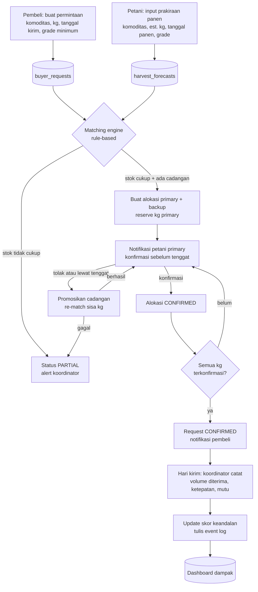
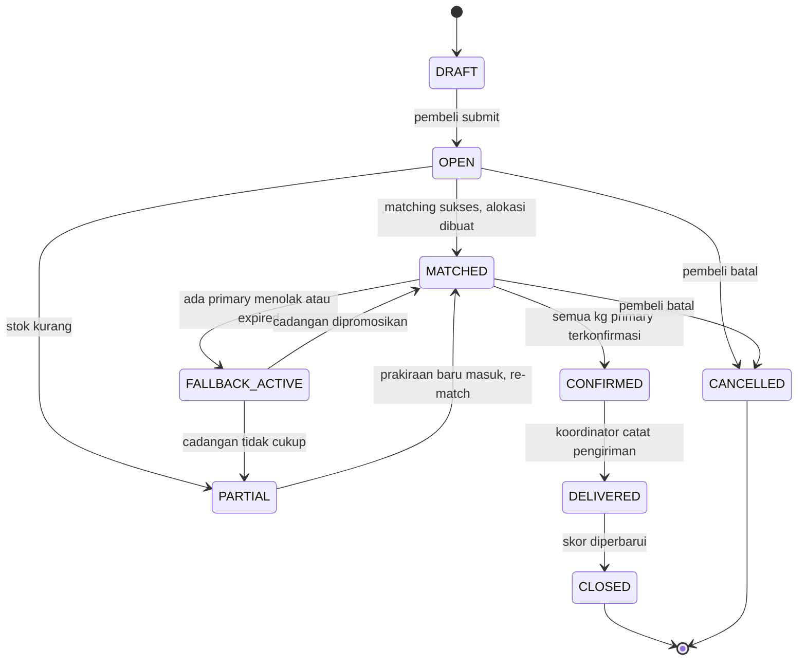
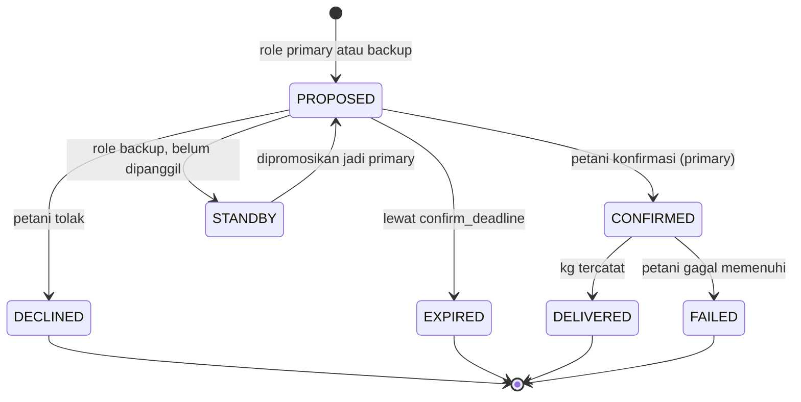
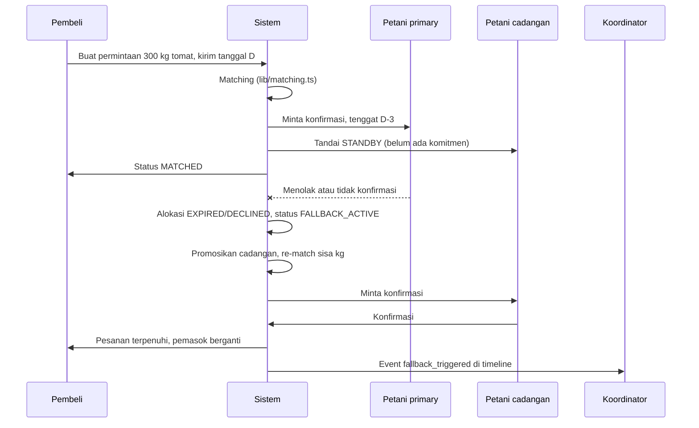

# AgriLink Bali: System Flow dan Build Spec (MVP Web App)

Dokumen ini adalah spesifikasi untuk dikerjakan Claude Code. Baca seluruhnya sebelum menulis kode. Kerjakan per milestone (bagian 12), jangan lompat.

Konteks: prototipe untuk Lomba Inovasi Bisnis Bali DigiFest 2026, subtema D (pemasaran dan pemanfaatan produk lokal). Tujuan prototipe adalah mendemonstrasikan SATU cerita utuh (hero scenario): sebuah hotel butuh 300 kg tomat per minggu, sistem mengalokasikan beberapa petani plus pemasok cadangan, lalu beralih otomatis ke cadangan ketika satu petani gagal.

---

## 1. Aturan yang tidak boleh dilanggar

1. **Semua data di aplikasi adalah SIMULASI.** Tampilkan banner permanen "DATA SIMULASI" di setiap halaman. Seed data tidak boleh meniru nama, nomor telepon, atau alamat orang atau usaha nyata. Pakai nama fiktif ("Kelompok Tani Contoh A").
2. **Matching berbasis aturan (rule-based).** Jangan memakai atau mengklaim AI/machine learning di kode, UI, maupun README.
3. **Tidak ada pelacakan armada, tidak ada API WhatsApp resmi** pada MVP. Notifikasi memakai tautan `wa.me` dengan teks terisi, plus notifikasi dalam aplikasi. Pembayaran sebelumnya tidak dibangun di M0–M6; **M7 (bagian 17) secara eksplisit menambahkan keranjang, checkout, dan pembayaran asli lewat Midtrans Snap** sebagai perluasan scope yang disetujui — lihat bagian 17 untuk aturannya, jangan bangun payment di luar M7.
4. **AgriLink tidak memiliki armada.** Pengiriman dilakukan pemasok dan/atau mitra logistik. Aplikasi hanya mencatat status dan hasil pengiriman.
5. **Titik konsolidasi (hub) belum ditetapkan.** Jangan menanam lokasi hub di kode. Hub adalah entri konfigurasi yang bisa diubah.
6. **Semua bobot, ambang, dan angka default adalah ASUMSI** yang disimpan di tabel `settings`, bukan konstanta tersembunyi.
7. UI berbahasa Indonesia. Nama variabel, tabel, dan kode berbahasa Inggris.
8. Tidak ada data pribadi nyata. `wa_number` hanya diisi nomor fiktif pada seed.

## 2. Stack

| Lapisan | Pilihan | Catatan |
|---|---|---|
| Framework | Next.js (App Router) + TypeScript | PWA: tambahkan manifest dan service worker sederhana |
| UI | Tailwind CSS + shadcn/ui | Mobile-first; petani memakai ponsel |
| Database dan auth | Supabase (Postgres, Auth, Row Level Security) | Login email + password cukup |
| Logika matching | Fungsi murni TypeScript di `lib/matching.ts` | Mudah diuji tanpa database |
| Tenggat otomatis | Tombol manual "Jalankan pengecekan tenggat" untuk demo; opsional Supabase scheduled function | Jangan bergantung pada cron saat demo |
| Tes | Vitest untuk `lib/matching.ts` dan `lib/scoring.ts` | Wajib lulus sebelum milestone M3 |
| Deploy | Vercel | |

## 3. Peran dan hak akses

| Peran | Bisa melakukan | Tidak boleh |
|---|---|---|
| `farmer` | CRUD prakiraan panen miliknya; melihat alokasi miliknya; konfirmasi atau tolak alokasi | Melihat data pembeli selain nama usaha dan kebutuhan pada alokasinya |
| `buyer` | Membuat dan melihat permintaan miliknya; melihat ketersediaan agregat 4 minggu; melihat status alokasi | Melihat identitas atau kontak petani (tampilkan nama kelompok samaran dan kabupaten) |
| `coordinator` | Melihat semua; override alokasi; promosikan cadangan manual; catat hasil pengiriman; jalankan pengecekan tenggat; simulasi kegagalan; kelola `settings` | Menghapus event log |

Terapkan Row Level Security di Supabase untuk semua tabel. Uji dengan tiga akun seed.

## 4. Alur sistem end-to-end



## 5. State machine

### 5.1 Permintaan pembeli (`buyer_requests.status`)



### 5.2 Alokasi (`allocations.status`)



## 6. Sequence: fallback ke pemasok cadangan (inti demo)



## 7. Algoritma matching (`lib/matching.ts`)

Fungsi murni, tanpa akses database. Data dimuat oleh pemanggil.

```ts
export type Grade = 'A' | 'B' | 'C';

export interface Forecast {
  id: string; farmerId: string; commodityId: string;
  estKg: number; reservedKg: number;
  expectedHarvestDate: string; // ISO date
  grade: Grade; farmerRegency: 'Tabanan' | 'Bangli' | string;
  reliability: number; // 0..1, default 0.5 untuk pemasok baru
}

export interface Request {
  id: string; commodityId: string; qtyKg: number;
  deliveryDate: string; minGrade: Grade; buyerRegency: string;
}

export interface Settings {
  weights: { reliability: number; proximity: number; gradeFit: number; freshness: number };
  maxSharePerSupplier: number;   // default 0.5
  backupBufferPct: number;       // default 0.3
  minBackupCount: number;        // default 1
  harvestLeadDays: number;       // panen paling lambat X hari sebelum kirim, default 1
  freshnessWindowDays: number;   // panen paling awal X hari sebelum kirim, default 7
  maxDistanceKm: number;         // untuk normalisasi jarak, default 100
}

export interface Allocation { forecastId: string; farmerId: string; kg: number; role: 'primary' | 'backup' }

export interface MatchResult {
  status: 'MATCHED' | 'PARTIAL';
  allocations: Allocation[];
  shortfallKg: number;          // kg primary yang belum terpenuhi
  backupCoveragePct: number;    // total kg backup / qtyKg
  notes: string[];
}

export function match(
  req: Request,
  forecasts: Forecast[],
  distanceKm: (fromRegency: string, toRegency: string) => number,
  s: Settings
): MatchResult;
```

Langkah:

1. **Filter kandidat:** komoditas sama; `grade >= minGrade` (A > B > C); `expectedHarvestDate` di antara `deliveryDate - freshnessWindowDays` dan `deliveryDate - harvestLeadDays`; `available = estKg - reservedKg > 0`.
2. **Skor tiap kandidat** (semua komponen 0..1):
   - `reliability` = skor keandalan pemasok.
   - `proximity` = `1 - min(distanceKm / maxDistanceKm, 1)`.
   - `gradeFit` = 1 jika grade tepat sama dengan `minGrade` atau lebih tinggi; 0.5 jika dua tingkat di atas (menghindari memakai grade tinggi untuk permintaan rendah). Boleh disederhanakan bila membingungkan.
   - `freshness` = makin dekat panen ke tanggal kirim, makin tinggi: `1 - (selisihHari / freshnessWindowDays)`.
   - `score = w.reliability*reliability + w.proximity*proximity + w.gradeFit*gradeFit + w.freshness*freshness`.
3. **Urutkan** menurun menurut skor. Seri: `available` terbesar dulu.
4. **Alokasi primary (greedy):** untuk tiap kandidat, `kg = min(available, qtyKg * maxSharePerSupplier, sisaKg)`; tambahkan sampai `sisaKg = 0`.
5. **Alokasi backup:** dari kandidat yang tersisa (urutan skor), tambahkan sebagai `backup` sampai total kg backup >= `qtyKg * backupBufferPct` DAN jumlah backup >= `minBackupCount`.
6. **Hasil:** `shortfallKg = sisaKg setelah langkah 4`. Status `MATCHED` jika `shortfallKg == 0` dan syarat backup terpenuhi; selain itu `PARTIAL` dengan `notes` yang menjelaskan apa yang kurang.

Catatan perilaku:
- Hanya alokasi `primary` menambah `reserved_kg` pada prakiraan. Backup tidak mengunci stok, jadi backup yang sama bisa muncul di beberapa permintaan. Saat dipromosikan, cek ulang `estKg - reservedKg`; jika sudah tidak cukup, ambil sebagian atau lewati.
- `promoteBackup(req, currentAllocations, forecasts, ...)`: hitung `kgYangHilang` dari alokasi DECLINED/EXPIRED/FAILED, isi dulu dari backup berurutan, sisanya dari kandidat baru dengan langkah 1-4. Kembalikan alokasi tambahan dan status baru.

### Skor keandalan (`lib/scoring.ts`)

Skor awal pemasok baru = 0.5. Setelah tiap pengiriman:

```
deliveryScore = 0.5 * min(deliveredKg / committedKg, 1)
              + 0.3 * (onTime ? 1 : 0)
              + 0.2 * (gradeOk ? 1 : 0)
newScore = 0.7 * oldScore + 0.3 * deliveryScore
```

Kasus FAILED: `deliveryScore = 0`. Angka 0.7/0.3 dan bobot di atas adalah ASUMSI, simpan di `settings`.

## 8. Model data (Postgres / Supabase)

```sql
create type user_role as enum ('farmer','buyer','coordinator');
create type grade_t as enum ('A','B','C');

create table profiles (
  id uuid primary key references auth.users(id),
  role user_role not null,
  display_name text not null,          -- nama samaran untuk tampilan
  org_name text,
  regency text not null,               -- 'Tabanan','Bangli','Badung','Denpasar'
  wa_number text,                      -- hanya nomor fiktif pada seed
  is_simulated boolean not null default true,
  created_at timestamptz default now()
);

create table commodities (
  id uuid primary key default gen_random_uuid(),
  name text unique not null,           -- 'Tomat','Kubis','Sawi','Mentimun', dst.
  shelf_life_days int
);

create table harvest_forecasts (
  id uuid primary key default gen_random_uuid(),
  farmer_id uuid not null references profiles(id),
  commodity_id uuid not null references commodities(id),
  est_kg numeric not null check (est_kg > 0),
  reserved_kg numeric not null default 0 check (reserved_kg >= 0),
  expected_harvest_date date not null,
  grade grade_t not null,
  status text not null default 'open',  -- 'open' | 'closed'
  created_at timestamptz default now(),
  check (reserved_kg <= est_kg)
);

create table buyer_requests (
  id uuid primary key default gen_random_uuid(),
  buyer_id uuid not null references profiles(id),
  commodity_id uuid not null references commodities(id),
  qty_kg numeric not null check (qty_kg > 0),
  delivery_date date not null,
  min_grade grade_t not null default 'B',
  recurrence text not null default 'none', -- 'none' | 'weekly'
  status text not null default 'DRAFT',
  shortfall_kg numeric not null default 0,
  created_at timestamptz default now()
);

create table allocations (
  id uuid primary key default gen_random_uuid(),
  request_id uuid not null references buyer_requests(id) on delete cascade,
  forecast_id uuid not null references harvest_forecasts(id),
  farmer_id uuid not null references profiles(id),
  role text not null check (role in ('primary','backup')),
  committed_kg numeric not null check (committed_kg > 0),
  status text not null default 'PROPOSED',
  confirm_deadline timestamptz,
  confirmed_at timestamptz,
  delivered_kg numeric,
  on_time boolean,
  grade_ok boolean,
  created_at timestamptz default now()
);

create table supplier_scores (
  farmer_id uuid primary key references profiles(id),
  score numeric not null default 0.5 check (score between 0 and 1),
  n_deliveries int not null default 0
);

create table zone_distance (          -- jarak antar kabupaten; nilai = ASUMSI, ganti dengan data rute nyata
  from_regency text not null,
  to_regency text not null,
  km numeric not null,
  primary key (from_regency, to_regency)
);

create table events (                 -- timeline audit untuk demo
  id bigserial primary key,
  request_id uuid references buyer_requests(id),
  type text not null,                 -- 'request_created','matched','partial','confirmed','declined','expired',
                                      -- 'fallback_triggered','backup_promoted','delivered','score_updated'
  payload jsonb,
  created_at timestamptz default now()
);

create table settings (
  key text primary key,
  value jsonb not null
);

create table baselines (              -- kondisi awal hasil wawancara, diisi manual
  metric text primary key,            -- 'fill_rate','shortage_events_per_month','local_volume_kg_per_month'
  value numeric,
  source text,                        -- wajib: 'DATA TIM: wawancara <tanggal>' atau 'ASUMSI'
  updated_at timestamptz default now()
);
```

Seed `settings` (semua ASUMSI):

```json
{
  "weights": {"reliability": 0.4, "proximity": 0.25, "gradeFit": 0.2, "freshness": 0.15},
  "maxSharePerSupplier": 0.5,
  "backupBufferPct": 0.3,
  "minBackupCount": 1,
  "harvestLeadDays": 1,
  "freshnessWindowDays": 7,
  "maxDistanceKm": 100,
  "confirmDeadlineDaysBeforeDelivery": 3
}
```

Seed `zone_distance` (ASUMSI, bukan data jarak resmi): Bangli-Denpasar 45, Bangli-Badung 55, Tabanan-Denpasar 30, Tabanan-Badung 40, dan sebaliknya.

## 9. Halaman dan rute

| Rute | Peran | Isi |
|---|---|---|
| `/login` | semua | Email + password |
| `/farmer/forecasts` | farmer | Daftar prakiraan panen miliknya, status stok terpakai |
| `/farmer/forecasts/new` | farmer | Form: komoditas, estimasi kg, tanggal panen, grade |
| `/farmer/allocations` | farmer | Alokasi yang menunggu konfirmasi: tombol Konfirmasi / Tolak, hitung mundur tenggat |
| `/buyer/availability` | buyer | Ketersediaan agregat per komoditas, 4 minggu ke depan (tanpa identitas petani) |
| `/buyer/requests` | buyer | Daftar permintaan dan status |
| `/buyer/requests/new` | buyer | Form: komoditas, kg, tanggal kirim, grade minimum, ulang mingguan |
| `/buyer/requests/[id]` | buyer | Status, kg terkonfirmasi vs diminta, daftar pemasok (nama samaran + kabupaten), timeline event |
| `/coordinator/dashboard` | coordinator | Metrik dampak (bagian 11) + input baseline |
| `/coordinator/requests/[id]` | coordinator | Alokasi lengkap, override, promosikan cadangan manual, catat pengiriman |
| `/coordinator/suppliers` | coordinator | Daftar pemasok, skor keandalan, jumlah pengiriman |
| `/coordinator/demo` | coordinator | Tombol demo: "Simulasikan petani gagal", "Jalankan pengecekan tenggat", "Reset data seed" |
| `/coordinator/settings` | coordinator | Edit nilai `settings` |

Aksi server (route handler atau Postgres function, pilih satu dan konsisten):

- `POST /api/requests/[id]/match`: muat prakiraan, panggil `match()`, simpan alokasi, naikkan `reserved_kg` primary, tulis event, ubah status.
- `POST /api/allocations/[id]/respond` body `{ action: 'confirm' | 'decline' }`: ubah status, tulis event, jika decline panggil promosi cadangan.
- `POST /api/system/check-deadlines`: tandai alokasi PROPOSED yang lewat `confirm_deadline` sebagai EXPIRED, lalu promosi cadangan.
- `POST /api/allocations/[id]/deliver` (koordinator) body `{ deliveredKg, onTime, gradeOk }`: catat hasil, perbarui skor, tutup permintaan bila semua alokasi selesai.
- `POST /api/demo/fail-supplier` (koordinator): tandai satu alokasi primary sebagai FAILED, picu fallback.
- `POST /api/demo/reset`: hapus dan seed ulang data simulasi.

## 10. Notifikasi

Tiap notifikasi dibuat sebagai baris in-app dan, untuk petani, tautan `wa.me` dengan teks terisi (nomor fiktif pada seed):

- Petani, konfirmasi: "Ada permintaan {kg} kg {komoditas} untuk pengiriman {tanggal}. Mohon konfirmasi sebelum {tenggat}. Buka: {url}"
- Petani cadangan dipromosikan: "Anda diminta menggantikan pemasok untuk {kg} kg {komoditas}, kirim {tanggal}. Konfirmasi: {url}"
- Pembeli, terkonfirmasi: "Permintaan {kg} kg {komoditas} terkonfirmasi untuk {tanggal}."
- Pembeli, pemasok berganti: "Salah satu pemasok diganti, total pesanan tetap terpenuhi."
- Koordinator, PARTIAL atau fallback gagal: "Permintaan {id} kurang {shortfallKg} kg."

Jangan sertakan identitas petani pada notifikasi pembeli.

## 11. Metrik dasbor dampak

Semua dihitung dari data aplikasi, ditampilkan berdampingan dengan baseline (tabel `baselines`) dan selalu berlabel sumber.

| Metrik | Definisi |
|---|---|
| `fill_rate` | sum(delivered_kg) / sum(qty_kg) untuk permintaan berstatus CLOSED |
| `shortage_events` | jumlah event bertipe `partial` atau `fallback_failed` per bulan |
| `fallback_rate` | permintaan dengan minimal satu `fallback_triggered` / total permintaan |
| `fallback_success_rate` | fallback yang berakhir CONFIRMED / total fallback |
| `on_time_rate` | alokasi DELIVERED dengan `on_time = true` / total DELIVERED |
| `local_volume_kg` | total `delivered_kg` per komoditas per bulan |

Penting: baseline (kondisi awal tanpa AgriLink) hanya boleh berisi data dari wawancara tim atau ditandai ASUMSI. Dasbor tidak boleh menyiratkan bahwa angka simulasi adalah hasil nyata.

## 12. Milestone dan kriteria selesai

| M | Pekerjaan | Selesai bila |
|---|---|---|
| M0 | Scaffold Next.js + Tailwind + shadcn, Supabase, skema bagian 8, RLS, 3 akun seed, banner DATA SIMULASI, login per peran | Tiap peran login dan hanya melihat rute miliknya; RLS menolak akses silang (uji manual dan 1 tes) |
| M1 | CRUD prakiraan panen (petani) + `/buyer/availability` | Petani menambah prakiraan; pembeli melihat agregat tanpa identitas |
| M2 | `lib/matching.ts` + `lib/scoring.ts` + tes Vitest; form permintaan; `POST .../match`; halaman detail permintaan | Tes lulus untuk: stok pas, stok kurang (PARTIAL), batas share per pemasok, filter grade dan tanggal, backup minimal 1; hero scenario menghasilkan MATCHED |
| M3 | Konfirmasi / tolak alokasi, transisi state, notifikasi in-app + tautan wa.me, timeline event | Semua transisi bagian 5 berjalan; event tercatat |
| M4 | Fallback: promosi cadangan, `check-deadlines`, tombol "Simulasikan petani gagal" | Skenario demo bagian 13 berjalan tanpa error, status akhir CONFIRMED atau PARTIAL dengan alasan jelas |
| M5 | Pencatatan pengiriman, pembaruan skor, dasbor metrik + input baseline | Angka dasbor cocok dengan perhitungan manual pada seed |
| M6 | PWA manifest, polesan UI Bahasa Indonesia, tombol reset seed, README dan skrip demo | Dapat dipasang di ponsel; demo penuh dari reset sampai dasbor dalam kurang dari 3 menit |
| M7 | Keranjang, checkout multi-item, order, dan pembayaran asli via Midtrans Snap (bagian 17) | Buyer login → tambah ke keranjang → checkout → bayar (sandbox) → order tercatat dengan status terverifikasi webhook; RLS diuji untuk semua tabel baru |

## 13. Seed data dan skrip demo (SEMUA SIMULASI)

Seed (nama fiktif, nilai bukan data riil dan tidak mewakili kapasitas petani sebenarnya):

- Pembeli: "Hotel Contoh A" (Badung).
- Petani, komoditas tomat, grade dan estimasi kg: Kelompok Tani Contoh 1 (Bangli, A, 140), 2 (Bangli, A, 110), 3 (Bangli, B, 90), 4 (Tabanan, A, 70), 5 (Bangli, A, 80), 6 (Tabanan, B, 60). Tanggal panen tersebar 2-5 hari sebelum tanggal kirim.
- Tambahkan 1-2 komoditas lain (sawi, kubis) dari kelompok Tabanan agar menu tidak hanya satu komoditas.

Skrip demo:

1. Login pembeli, buat permintaan 300 kg tomat grade minimum B, kirim minggu depan.
2. Sistem MATCHED: tampil primary dan cadangan, kg terkonfirmasi masih 0.
3. Login dua petani primary, konfirmasi. Koordinator menekan "Simulasikan petani gagal" untuk primary ketiga.
4. Sistem FALLBACK_ACTIVE, cadangan dipromosikan dan dimintai konfirmasi, konfirmasi, status kembali CONFIRMED.
5. Koordinator mencatat pengiriman. Dasbor menampilkan fill_rate, fallback_rate, dan skor pemasok berubah.

## 14. Sengaja tidak dibuat pada MVP

Invoice formal/akuntansi; pelacakan GPS atau armada; WhatsApp Business API; peramalan panen otomatis; rating pembeli ke petani; multi-hub; aplikasi native. Boleh disebut sebagai tahap lanjutan di proposal, tidak untuk dibangun sekarang. (Pembayaran sendiri kini masuk scope lewat M7, bagian 17 — bukan lagi "sengaja tidak dibuat".)

## 15. Keputusan terbuka (jangan diputuskan sendiri oleh Claude Code)

1. Titik konsolidasi: hub fisik atau koordinasi virtual. Biarkan sebagai konfigurasi.
2. Model pendapatan (komisi, langganan, atau margin hub). Jangan membangun logika tagihan.
3. Angka bobot, ambang, jarak, dan seed adalah ASUMSI sampai ada hasil wawancara. Ubah lewat `settings`, bukan kode.

## 16. Prompt pembuka untuk Claude Code

> Baca `AGRILINK_SYSTEM_FLOW.md` sampai habis. Kerjakan HANYA milestone M0 dulu. Ikuti bagian 1 (aturan) tanpa pengecualian. Setelah M0 selesai, jalankan tes dan tunjukkan hasilnya, lalu berhenti dan tanya apakah boleh lanjut ke M1. Jika ada hal ambigu atau keputusan terbuka (bagian 15), tanyakan, jangan menebak.

## 17. M7 — Keranjang, checkout, dan pembayaran asli (Midtrans Snap)

Perluasan scope yang disetujui secara eksplisit di luar hero scenario M0–M6. Buyer-request/matching (bagian 4-7) tetap berjalan tanpa diubah; M7 menambah jalur belanja langsung dari katalog, terpisah dari alur "ajukan kebutuhan".

### 17.1 Aturan tambahan

1. Pembayaran memakai **Midtrans Snap**, mode sandbox sampai kredensial merchant produksi dikonfigurasi. `MIDTRANS_SERVER_KEY` hanya dipakai di server (Server Action/route handler), tidak pernah dikirim ke client, dicatat di log, atau di-commit.
2. Status pembayaran hanya berubah dari webhook Midtrans yang tervalidasi signature-nya atau hasil `transaction status` API yang diverifikasi server — bukan dari redirect/callback sisi client.
3. Checkout wajib idempotent (idempotency key per percobaan) agar retry tidak membuat order ganda atau pembayaran dobel.
4. Harga dan rincian item (nama, grade, pemasok, harga satuan, kg) dibekukan di server saat checkout dari data tepercaya (katalog/commodity), bukan dari input client.
5. Reservasi stok saat checkout mengikuti pola `reserved_kg` yang sama seperti matching, dengan kedaluwarsa agar keranjang yang ditinggalkan melepas stok.
6. Banner `DATA SIMULASI` dan aturan data fiktif tetap berlaku di seluruh UI kecuali transaksi Midtrans itu sendiri; checkout tetap menandai jelas bahwa ini pembayaran sandbox/demo sampai kredensial produksi aktif.
7. `lib/matching.ts`/`lib/scoring.ts` tidak disentuh oleh M7.

### 17.2 Tabel baru (Postgres/Supabase)

```sql
create table carts (
  id uuid primary key default gen_random_uuid(),
  buyer_id uuid not null references profiles(id),
  status text not null default 'active' check (status in ('active','checked_out','abandoned')),
  created_at timestamptz not null default now()
);

create table cart_items (
  id uuid primary key default gen_random_uuid(),
  cart_id uuid not null references carts(id) on delete cascade,
  product_id text not null, -- catalog product id (lib/catalog-data.ts)
  commodity_id uuid references commodities(id),
  qty_kg numeric not null check (qty_kg > 0),
  created_at timestamptz not null default now(),
  unique (cart_id, product_id)
);

create table orders (
  id uuid primary key default gen_random_uuid(),
  buyer_id uuid not null references profiles(id),
  cart_id uuid references carts(id),
  idempotency_key text not null unique,
  status text not null default 'PENDING_PAYMENT'
    check (status in ('PENDING_PAYMENT','PAID','EXPIRED','CANCELLED','FAILED')),
  total_amount numeric not null check (total_amount >= 0),
  currency text not null default 'IDR',
  created_at timestamptz not null default now()
);

create table order_items (
  id uuid primary key default gen_random_uuid(),
  order_id uuid not null references orders(id) on delete cascade,
  product_id text not null,
  product_name text not null,
  supplier_label text not null,
  grade grade_t not null,
  unit_price numeric not null check (unit_price >= 0),
  qty_kg numeric not null check (qty_kg > 0),
  subtotal numeric not null check (subtotal >= 0)
);

create table payment_transactions (
  id uuid primary key default gen_random_uuid(),
  order_id uuid not null references orders(id) on delete cascade,
  midtrans_order_id text not null unique,
  snap_token text,
  status text not null default 'pending',
  raw_response jsonb,
  created_at timestamptz not null default now()
);

create table payment_webhook_events (
  id bigserial primary key,
  midtrans_order_id text not null,
  payload jsonb not null,
  signature_valid boolean not null,
  received_at timestamptz not null default now()
);

create table stock_reservations (
  id uuid primary key default gen_random_uuid(),
  order_id uuid not null references orders(id) on delete cascade,
  product_id text not null,
  qty_kg numeric not null check (qty_kg > 0),
  expires_at timestamptz not null
);
```

RLS: buyer akses baris miliknya sendiri (`buyer_id = auth.uid()`) sama seperti `buyer_requests`; `payment_webhook_events`/`payment_transactions` tulis hanya lewat service role (server), baca terbatas pemilik order atau coordinator. Terapkan pola `current_user_role()` yang sudah ada.

### 17.3 Alur checkout

1. Buyer login → tambah produk katalog ke `carts`/`cart_items` (server action, qty per produk).
2. Checkout: server membuat `orders` + `order_items` dari harga/stok tepercaya saat itu, buat `stock_reservations` dengan kedaluwarsa singkat, request Snap token ke Midtrans dengan `idempotency_key`.
3. Buyer membayar lewat Snap (sandbox).
4. Midtrans mengirim webhook → server validasi signature, catat di `payment_webhook_events`, update `payment_transactions` dan `orders.status` jadi `PAID`/`FAILED`/`EXPIRED`.
5. Order `PAID` → stok dikurangi permanen dari reservasi; order masuk riwayat buyer.
